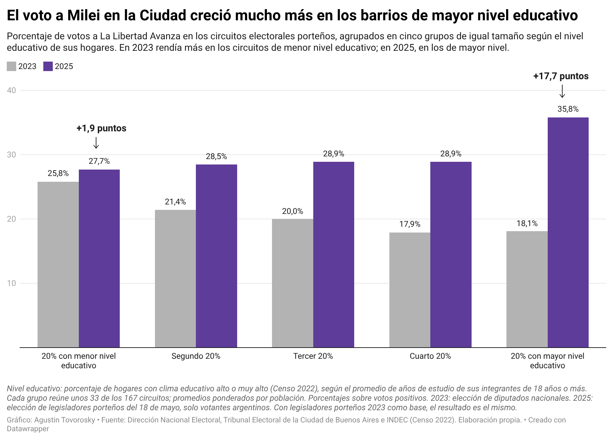
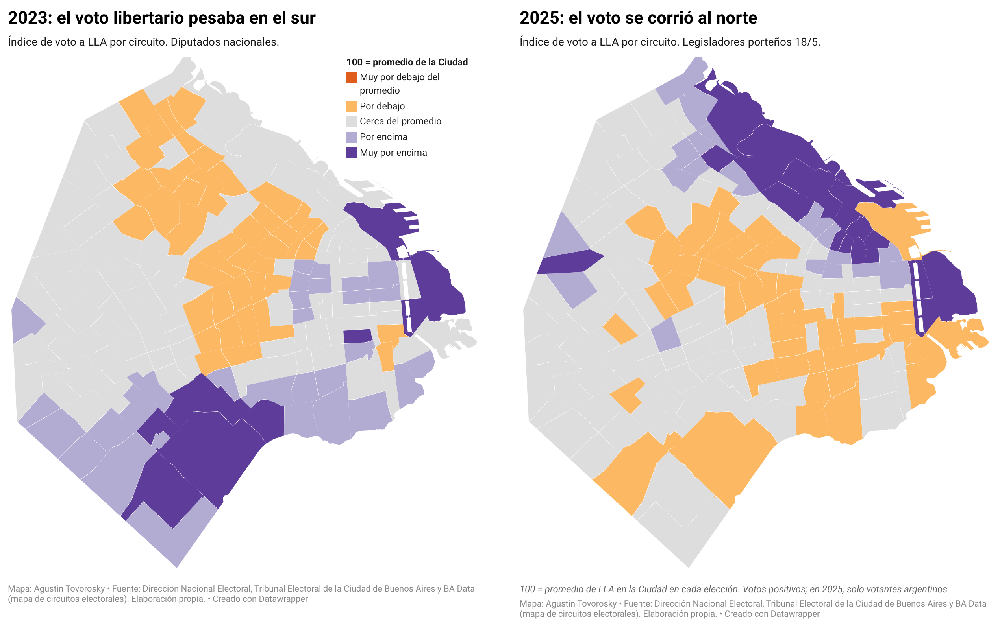
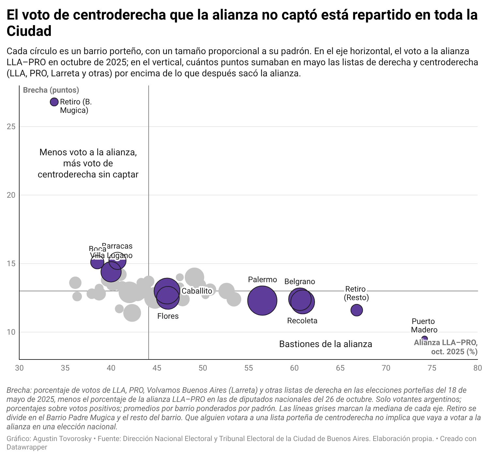

# ¿Quién vota hoy a la derecha porteña?

**Nivel socioeconómico, abstención y la alianza LLA–PRO, circuito por circuito (2023–2025)**

📄 Nota completa: https://agustovo.substack.com/p/en-2023-milei-pescaba-en-el-sur-en?r=29of0z&utm_campaign=post&utm_medium=web&showWelcomeOnShare=true

Análisis de los 167 circuitos electorales de la Ciudad de Buenos Aires en tres elecciones (generales 2023, legislativas porteñas del 18 de mayo de 2025 y legislativas nacionales del 26 de octubre de 2025), cruzados con el Censo 2022.



## Principales hallazgos

- **El voto libertario cambió de barrio.** En 2023, La Libertad Avanza rendía más en los circuitos de menor nivel educativo (25,8% contra 18,1% en los de mayor nivel). En mayo de 2025 se mantuvo en el sur (27,7%) y saltó en el norte (35,8%).
- **El voto se volvió más transversal.** En 2023, el nivel educativo, la edad y la migración explicaban el 81% de las diferencias entre circuitos; en 2025, el 32%.
- **La alianza LLA–PRO retuvo el voto de los dos** en casi toda la Ciudad. La gran excepción es el Barrio Padre Mugica, donde sacó 10 puntos menos que la suma de mayo.
- **La abstención golpeó más a los barrios populares.** La participación cayó de 75,4% (2023) a 62,4% (mayo 2025), y la caída fue mayor donde hay más hogares migrantes.
- **El voto de centroderecha que la alianza no captó está repartido en toda la Ciudad:** entre 11 y 16 puntos en la gran mayoría de los barrios.



## Fuentes

| Dato | Fuente |
| --- | --- |
| Elecciones generales 2023 | [DINE, resultados provisorios por mesa](https://datos.gob.ar/dataset/resultados-provisionales-elecciones-20231) |
| Legislativas porteñas, 18/5/2025 | [Tribunal Electoral de la Ciudad](https://resultados.electoralcaba.gob.ar), por escuela y mesa |
| Legislativas nacionales, 26/10/2025 | [DINE, resultados provisorios por mesa](https://datos.gob.ar/dataset/elecciones_legislativas_2025) |
| Circuitos electorales | [BA Data](https://data.buenosaires.gob.ar/dataset/circuitos-electorales) |
| Censo 2022 por radio censal | INDEC, versión procesada en [source.coop](https://source.coop/nlebovits/censo-argentino/2022) |
| Electores y participación de mayo 2025 | [Estadística Ciudad](https://www.estadisticaciudad.gob.ar/eyc/wp-content/uploads/2026/08/Elecciones_2025_CABA.pdf) |

## Metodología

- **Reconstrucción de mayo 2025 por circuito.** Los resultados no estaban publicados por circuito. Se descargaron las 1.113 escuelas del sitio del Tribunal Electoral y se asignó cada una a su circuito con el listado de escuelas de octubre 2025 (nombre exacto, similitud revisada a mano, números de mesa y, en escuelas con varias sedes, mesa por mesa). La suma por comuna coincide con el total oficial; quedan fuera 870 votos (0,05%) de mesas sin ubicación territorial.
- **Voto extranjero.** En mayo votaron extranjeros residentes; en octubre, solo argentinos. Sus mesas (9.001 a 10.552) se descargaron por separado y se restaron para comparar universos iguales.
- **Denominador.** Porcentajes sobre votos positivos, como informa la Dirección Nacional Electoral.
- **Censo → circuitos.** 3.820 radios censales asignados a circuitos por proporción de área. La población censal por circuito tiene una correlación de 0,94 con el padrón.
- **Indicador principal.** Porcentaje de hogares con clima educativo alto o muy alto. Los circuitos se agrupan en quintiles ponderados por población.
- **Modelos.** Regresión lineal ponderada por población, con variables estandarizadas (statsmodels).
- **Robustez.** Todo se repitió usando legisladores porteños 2023 como base, con iguales conclusiones.

## Limitaciones

- **Falacia ecológica:** los resultados describen territorios, no personas.
- **Resultados provisorios** en los datos de la DINE.
- **Categorías e instrumentos de voto distintos** entre elecciones (boleta partidaria y electrónica en 2023, boleta única electrónica en mayo 2025, boleta única de papel en octubre 2025).
- El "voto de centroderecha" sale de una elección local: votar a una lista porteña no implica votar a la misma opción en una elección nacional.



## Cómo reproducirlo

1. Cloná el repo e instalá las dependencias:
   ```bash
   pip install -r requirements.txt
   ```
2. Abrí `proyecto_caba_electoral_2023_2025.ipynb` (funciona en Google Colab o Jupyter).
3. La primera vez, poné `DESCARGAR = True` en la sección de configuración para bajar los datos de las fuentes oficiales a `data/raw/`. Después dejalo en `False`.
4. Ejecutá todo de principio a fin. La última sección corre las validaciones contra los totales oficiales.

Las tablas ya procesadas por circuito están en `data/processed/`, para quien quiera revisar los números sin correr el scraping.

## Estructura

```
caba-electoral-2023-2025/
├── README.md
├── LICENSE
├── requirements.txt
├── .gitignore
├── proyecto_caba_electoral_2023_2025.ipynb
├── data/
│   ├── raw/          (no se sube; se genera con DESCARGAR = True)
│   └── processed/    (tablas por circuito y CSV de los gráficos)
└── img/
```

## Autor

**Agustin Tovorosky**

Gráficos hechos con [Datawrapper](https://www.datawrapper.de).

LinkedIn: https://www.linkedin.com/in/agustin-tovorosky-9aa779148/

Código bajo licencia MIT. Los datos pertenecen a sus fuentes originales.
